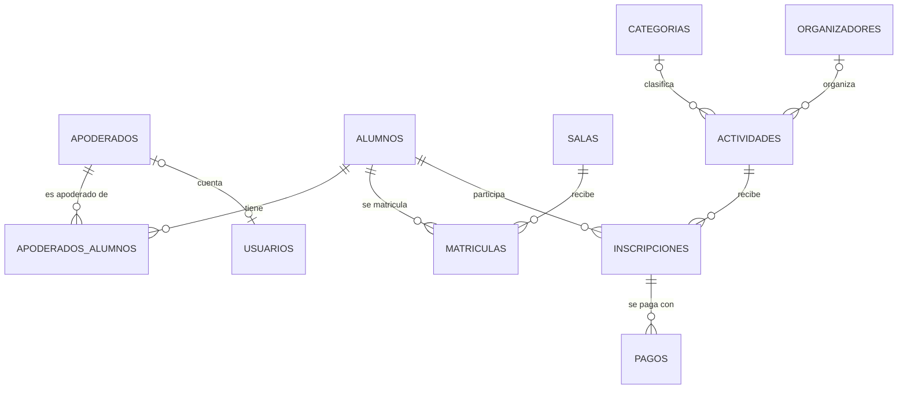

# Modelo PostgreSQL y migraciones reproducibles (TEC-16)

> **ID estable:** PR-S3/TEC-16 · **Referencias previas:** SCRUM-62, 63 · **Dependencia:** SCRUM-93
> **Revisor cruzado:** Daniel Cortez · **Restricción:** solo datos ficticios.

## En pocas palabras

- La base de datos del jardín se arma con **migraciones**: archivos SQL numerados que crean las tablas siempre en el mismo orden y de la misma forma. Cualquier integrante obtiene **la misma base con un solo comando**, partiendo de cero.
- Se agregaron las tablas de **usuarios, categorías, pagos ficticios y datos del jardín**, y las actividades quedaron ligadas a una categoría, a un **organizador** (tabla `organizadores` de HU-17) y a un costo.
- La API tiene un **CRUD** para administrar eventos (actividades con cupos de HU-19) y categorías, y para registrar **pagos simulados**.

## Cómo funcionan las migraciones

```
backend/sql/
├── migrar.sh                 ← aplica las migraciones y carga los datos demo
├── initdb/00_migrar.sh       ← Docker lo ejecuta solo la primera vez (base vacía)
├── migraciones/              ← SOLO el esquema: tablas, restricciones e índices
│   ├── V001__esquema_base.sql                     (incluye las tablas de HU-17/18/20/27)
│   ├── V002__inscripciones.sql                    (tablas de HU-19)
│   └── V003__usuarios_eventos_pagos_institucion.sql
└── seed/                     ← SOLO datos de demostración, todos ficticios
    ├── S001__datos_demo.sql
    └── …
```

- **Las migraciones son la única fuente del esquema.** La API no crea tablas por su cuenta.
- **Registro:** la tabla `schema_migraciones` guarda qué migración se aplicó y cuándo. El ejecutor solo aplica las que faltan, así que se puede correr las veces que se quiera.
- **Todo o nada:** cada migración se aplica en una transacción. Si falla a la mitad, se deshace completa y el ejecutor se detiene.
- **Una migración aplicada no se edita:** los cambios de esquema van en una migración nueva (`V004`, `V005`…).
- **Windows y Linux por igual:** el ejecutor ignora los saltos de línea de Windows, y `.gitattributes` obliga a guardar los `.sh` con saltos LF.

## El modelo



| Tabla | Para qué | Migración |
|---|---|---|
| `apoderados`, `alumnos`, `apoderados_alumnos`, `salas`, `matriculas` | Familias, salas y matrículas | V001 |
| `organizadores`, `categorias_actividad`, `actividades_escolares`, `inscripciones_pagos`, `documentos_institucionales` | Tablas de HU-17, HU-18, HU-20 y HU-27 | V001 |
| `actividades`, `inscripciones` | Los **eventos** del jardín (salidas, talleres) y quién se inscribe | V002 + V003 |
| `usuarios` | Cuentas con rol `apoderado`, `organizador` o `administrador` | V003 |
| `categorias` | Tipo de actividad: Taller, Salida pedagógica… | V003 |
| `pagos` | Pagos **ficticios** de actividades con costo | V003 |
| `institucion` | Datos del jardín (una sola fila) | V003 |

> **«Eventos» = actividades de HU-19.** El ticket habla de «eventos»; en Pequeños Reyes son las actividades con cupos de HU-19, así que se ampliaron esas tablas (categoría, organizador y costo) en vez de crear otra. En la API se publican en `/api/v1/eventos`, porque `/api/v1/actividades` son las actividades escolares de HU-18.
>
> **Organizadores:** se usa la tabla `organizadores` de HU-17 (nombre, correo, perfil y teléfono), que también se administra con sus endpoints `/api/v1/organizadores`. Los datos demo agregan dos organizadoras ficticias.

### Reglas que garantiza la propia base (CA2)

Aunque la API tuviera un error, PostgreSQL rechaza estos datos por su cuenta:

| Regla | Cómo |
|---|---|
| Un alumno, una inscripción por actividad | `UNIQUE (actividad_id, alumno_id)` |
| Como máximo un pago aprobado por inscripción | Índice único parcial |
| Los pagos solo pueden ser simulados (método `simulado`, referencia `SIM-…`) | `CHECK` |
| Montos, cupos y costos válidos | `monto > 0`, `cupo_maximo > 0`, `costo >= 0` |
| Correos únicos y en minúsculas | `UNIQUE` + `CHECK` |
| Un usuario «apoderado» debe estar ligado a un apoderado, y ningún otro rol puede estarlo | `CHECK` |
| Una sola fila de datos del jardín | `CHECK (id = 1)` |
| No se borran datos que otros usan (una categoría con actividades, una inscripción con pagos…) | `ON DELETE RESTRICT` |

### Privacidad (CA3 y CA5)

- Los datos de demostración **son todos inventados**: correos `@ejemplo.cl`, alumnos `DEMO-A01`… llamados «Alumno Demo», dirección «Calle Ficticia 123».
- **No se guardan fechas de nacimiento** de los alumnos.
- **Pagos:** no hay columnas para tarjetas ni cuentas, y la base rechaza cualquier método que no sea `simulado`.
- **Contraseñas:** los usuarios demo tienen `demo-sin-contrasena`, que no es un hash real, así que no sirven para iniciar sesión.

## CRUD en la API (CA4)

| Recurso | Endpoints | Reglas |
|---|---|---|
| Datos del jardín | `GET /api/v1/institucion` | — |
| Categorías | `GET`, `POST /api/v1/categorias` | Nombre repetido → 409 |
| Eventos | `POST /api/v1/eventos`, `PATCH` y `DELETE /api/v1/eventos/{id}` | Ver abajo |
| Pagos simulados | `POST`, `GET /api/v1/inscripciones/{id}/pagos` | Ver abajo |

- **Crear evento:** código único en MAYÚSCULAS; la categoría y el organizador deben existir (si no, 404); cupo entre 1 y 500; costo de 0 o más.
- **Modificar evento:** se cambia solo lo que se envía. **No se puede bajar el cupo por debajo de los inscritos** (409).
- **Eliminar evento:** solo si no tiene inscripciones (si tiene, 409, para conservar el historial). Para que no reciba más inscripciones se cierra con `inscripciones_abiertas = false`.
- **Pagar:** solo el apoderado del alumno (si no, 403), solo inscripciones vigentes de actividades con costo, y una sola vez (409). El monto es el costo de la actividad y la referencia se genera sola (`SIM-…`).
- **Cancelar una inscripción pagada:** la cancelación y el **reembolso** del pago se guardan **en la misma transacción**: o se guardan los dos o ninguno.

## Cómo usarlo

Desde `HITO-3/backend`:

```bash
docker compose up -d --build                     # con una base vacía, migra y carga los datos solo
docker compose exec postgres sh /sql/migrar.sh   # en una base existente, aplica lo que falte
```

La salida se ve así (en una segunda ejecución, cada migración aparece como `= ... (ya aplicada)`):

```
== Migraciones ==
  + V001__esquema_base aplicada
  + V002__inscripciones aplicada
  ...
== Datos de demostración ==
  + S001__datos_demo.sql cargado
  ...
Listo.
```

Para partir **desde cero** (borra los datos de PostgreSQL y MongoDB del computador):

```bash
docker compose down -v
docker compose up -d --build
```

**Para agregar un cambio de esquema:** crear `sql/migraciones/V004__descripcion.sql`, actualizar el modelo en `app/db/models.py` y ejecutar `migrar.sh`.

## Cómo probarlo

1. **Base de datos, sin tocar tus datos:** `bash docs/evidencia/TEC-16/pruebas-postgresql.sh`. Crea bases temporales, comprueba las migraciones desde cero (y repetidas), las restricciones, que una migración que falla no deja nada a medias y que los datos son ficticios. Al final las borra.
2. **API, con un reinicio en medio (CA4):**
   ```bash
   docker compose exec api python -m scripts.prueba_tec16 crear
   docker compose restart
   docker compose exec api python -m scripts.prueba_tec16 verificar
   ```
   - `crear` (20 casos): migraciones registradas, datos del jardín, CRUD, pago simulado, cancelación con reembolso y 9 casos de error (400, 403, 404 y 409).
   - `verificar` (4 casos): después del reinicio, la actividad, sus cambios, sus inscripciones y sus pagos siguen intactos. Luego borra todo lo de prueba.
3. **Indisponibilidad (503):** `docker compose stop postgres` → `GET /api/v1/categorias` responde 503 → `docker compose start postgres`.

## Evidencia

`docs/evidencia/TEC-16/pruebas-postgresql.txt`, en un **PostgreSQL 16 real**:

| Prueba | Resultado |
|---|---|
| Migraciones desde una base vacía (V001 a V003) y datos demo | ✅ |
| Volver a ejecutar el migrador | ✅ No aplica nada nuevo ni duplica datos |
| 17 restricciones del modelo | ✅ Todas rechazan el dato inválido |
| Migración que falla a la mitad | ✅ Se deshace completa |
| Datos demo fuera de `@ejemplo.cl` o `DEMO-*` | ✅ 0 |

> **Falta ejecutar la API real.** En el equipo donde se programó no se pudieron instalar FastAPI ni SQLAlchemy. El código se revisó con `pyflakes`, y la base de datos sí se probó en PostgreSQL 16 real. El equipo debe ejecutar el paso 2 y guardar las salidas.

## Decisiones para validar con el equipo

1. **La API no ejecuta `create_all()` al arrancar**: con dos fuentes de esquema, las migraciones no serían reproducibles. Las pruebas `tests_hu*.py` de HU-17, HU-18, HU-20 y HU-27 no cambian: usan su propia base SQLite en memoria.
2. **Migraciones con SQL y `sh`, sin Alembic**, para no sumar dependencias y poder leerlas y probarlas directamente en PostgreSQL.
3. **Eventos = actividades** (ver «El modelo»).
4. **Una sola tabla de organizadores:** se reutiliza la de HU-17 en vez de crear otra con el mismo nombre; las actividades de HU-19 apuntan a ella.
5. **Datos del jardín ficticios**, porque el criterio exige datos de demostración. Usar los reales hay que decidirlo con el docente.
6. **Usuarios sin endpoints todavía:** la tabla queda lista para el futuro inicio de sesión.
7. **Restricción académica:** si esto equivale al **caso 3.6** de la pauta (eventos, organizadores, categorías, pagos), hay que ratificarlo con el docente.

## Qué falta para cerrar la tarea

- [ ] Ejecutar `pruebas-postgresql.sh` y las dos fases de `prueba_tec16` en Docker, y guardar las salidas en `docs/evidencia/TEC-16/`.
- [ ] Capturas de Swagger del CRUD y de un error 409.
- [ ] PR revisado por Daniel Cortez.

<details>
<summary><strong>Detalles técnicos</strong> (archivos de esta carpeta)</summary>

| Archivo | Qué contiene |
|---|---|
| `sql/migrar.sh` | Ejecutor de migraciones en `sh` POSIX (funciona en `postgres:16-alpine`): tabla de registro, una transacción por migración y carga de datos demo (`CARGAR_SEED=no` para omitirlos). |
| `sql/initdb/00_migrar.sh` | Lo ejecuta Docker solo la primera vez, con un volumen vacío. |
| `sql/migraciones/V001__esquema_base.sql` | Esquema base del proyecto: apoderados, alumnos, salas, matrículas y las tablas de HU-17, HU-18, HU-20 y HU-27 (el mismo contenido que tenía `sql/001_schema.sql`). |
| `sql/migraciones/V002__inscripciones.sql` | Tablas de HU-19 (`actividades`, `inscripciones` y la vista de asistentes), que antes estaban en `sql/002_inscripciones.sql`. |
| `sql/migraciones/V003__usuarios_eventos_pagos_institucion.sql` | Usuarios, categorías, pagos simulados, institución y las columnas nuevas de actividades (categoría, organizador y costo). |
| `sql/seed/S001__datos_demo.sql` | Datos ficticios: jardín, categorías, cuentas demo, organizadoras, y los apoderados, alumnos y actividades demo de HU-19. Se puede cargar varias veces sin duplicar. |
| `.gitattributes` | Los `.sh` siempre con saltos de línea LF. |
| `docker-compose.yml` | Monta `sql/` en el contenedor de PostgreSQL y el arranque automático. |
| `app/main.py` | Registra el router `catalogo` y ya no crea tablas al arrancar (`create_all`). |
| `app/db/models.py` | Modelos `Usuario`, `Categoria`, `Pago` e `Institucion`, y columnas nuevas de `Actividad` (el modelo `Organizador` es el de HU-17). |
| `app/schemas/catalogo.py`, `app/services/catalogo.py`, `app/api/catalogo.py` | Institución y categorías. |
| `app/schemas/inscripciones.py`, `app/services/inscripciones.py`, `app/api/inscripciones.py` | CRUD de eventos y pagos simulados (junto con lo de HU-19). |
| `scripts/utilidades.py`, `scripts/prueba_tec16.py` | Prueba de la API en dos fases. |
| `docs/evidencia/TEC-16/` | Script y resultado de las pruebas en PostgreSQL. |

**Archivos que se eliminan:** `sql/001_schema.sql` (su contenido quedó en `V001`) y `sql/002_inscripciones.sql` (sus tablas quedaron en `V002` y sus datos demo en `S001`).

</details>
