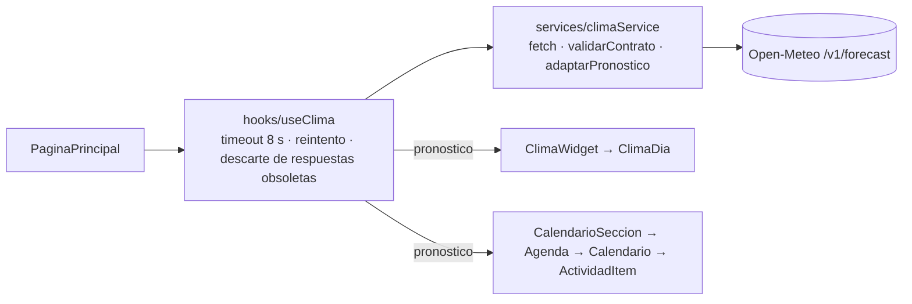

# API pública: Open-Meteo (pronóstico del clima)

**Incidencia:** TEC-06 (SCRUM-54).
**Relacionadas:** TEC-04 (servicio HTTP), TEC-05 (`useClima`), HU-05 (widget) y HU-06 (clima por actividad).
**Fecha de la petición real registrada:** 09-11-2026, 15:56 (hora de Chile).

## Ficha en 11 puntos

| # | Punto | Contenido (según el código actual) |
|---|---|---|
| 1 | Nombre | Open-Meteo — Weather Forecast API |
| 2 | Documentación oficial | https://open-meteo.com/en/docs |
| 3 | Endpoint | `https://api.open-meteo.com/v1/forecast` (`src/services/climaService.js`) |
| 4 | Método HTTP | `GET` |
| 5 | Parámetros | `latitude=-33.0153`, `longitude=-71.5500` (Viña del Mar), `daily=weather_code,temperature_2m_max,temperature_2m_min,precipitation_probability_max,uv_index_max`, `timezone=America/Santiago`, `forecast_days=7` |
| 6 | Datos utilizados | `daily.time`, `daily.weather_code` (código WMO → texto con `obtenerCondicionClima`), `daily.temperature_2m_max`, `daily.temperature_2m_min`, `daily.precipitation_probability_max`, `daily.uv_index_max` y `daily_units` |
| 7 | Dónde se usa en la interfaz | `ClimaWidget` (tarjetas de 7 días con recomendaciones) e insignia de clima en cada `ActividadItem` del calendario cuya fecha esté dentro del pronóstico (HU-06) |
| 8 | Si la API falla | Mientras carga se muestra el estado de carga. Si hay error HTTP, fallo de red, *timeout* de 8 s (`AbortController` en `useClima`) o contrato inválido (`validarContrato`), aparece un mensaje con botón **Reintentar**. El calendario se muestra igual, sin insignias: `PaginaPrincipal` pasa un pronóstico vacío |
| 9 | Restricciones | Sin API key ni autenticación. Uso gratuito **no comercial**. Límites publicados: menos de 10.000 llamadas/día, 5.000/hora y 600/minuto. Una carga por montaje y por reintento, sin *polling*. En desarrollo, `StrictMode` puede iniciar una solicitud adicional; abortarla no garantiza que el servidor no la reciba |
| 10 | Licencia y atribución | Datos bajo **CC BY 4.0**. El widget muestra la atribución «Datos meteorológicos: Open-Meteo.com» con enlace. Las recomendaciones son elaboración del equipo a partir del pronóstico |
| 11 | Justificación | El jardín hace actividades al aire libre y los párvulos son sensibles a la radiación UV, la lluvia y el frío. El pronóstico ayuda a las familias a preparar bloqueador, ropa de cambio o abrigo |

La licencia de los datos (CC BY 4.0) y las condiciones de acceso al servicio (gratuito solo para uso
no comercial) son asuntos distintos. Para una operación comercial del jardín habría que revisar el
plan de pago de Open-Meteo.

**Privacidad:** a Open-Meteo solo se envían coordenadas fijas del jardín. Nunca se envían RUT,
nombres, datos de alumnos ni credenciales.

## Arquitectura



`useClima` se llama **una sola vez** (en `PaginaPrincipal`), y el modelo se distribuye por props
(HU-06).

## Petición y respuesta reales (09-11-2026, 15:56)

```
GET https://api.open-meteo.com/v1/forecast?latitude=-33.0153&longitude=-71.5500&daily=weather_code,temperature_2m_max,temperature_2m_min,precipitation_probability_max,uv_index_max&timezone=America%2FSantiago&forecast_days=7
→ HTTP 200 (0,77 s)
```

Respuesta (extracto textual de los campos usados):

```json
{"latitude": -32.934975, "longitude": -71.47058, "timezone": "America/Santiago",
 "daily_units": {"time": "iso8601", "weather_code": "wmo code", "temperature_2m_max": "°C",
                 "temperature_2m_min": "°C", "precipitation_probability_max": "%", "uv_index_max": ""},
 "daily": {"time": ["2026-11-09","2026-11-10","2026-11-11","2026-11-12","2026-11-13","2026-11-14","2026-11-15"],
           "weather_code": [53,51,45,45,1,45,53],
           "temperature_2m_max": [21.3,23.9,23.4,24.1,23.6,22.5,22.0],
           "temperature_2m_min": [14.0,16.1,14.1,15.2,15.0,15.4,16.1],
           "precipitation_probability_max": [80,71,0,0,0,8,29],
           "uv_index_max": [8.6,8.85,8.45,8.45,9.05,9.05,9.0]}}
```

Open-Meteo ajusta las coordenadas a la celda de su modelo: pedimos −33,0153 / −71,5500 y responde
−32,935 / −71,471.

## Reglas de interpretación (`src/utils/clima.js`)

**Códigos WMO.** Se usa un mapa explícito con todos los códigos documentados:
- 0, 1, 2, 3 · 45/48 niebla · 51/53/55 llovizna · 56/57 llovizna engelante
- 61/63/65 lluvia · 66/67 lluvia engelante · 71/73/75 nieve · 77 granos de nieve
- 80/81/82 chubascos · 85/86 chubascos de nieve · 95 tormenta · 96/99 tormenta con granizo

Un código no documentado muestra «Condición no disponible».

**Recomendaciones, en orden de prioridad:**
1. Probabilidad de lluvia ≥ 60 % → «Llevar protección para la lluvia.»
2. Índice UV ≥ 6 → «Se recomienda protección frente al sol.»
3. Mínima ≤ 7 °C → «Se recomienda llevar ropa abrigada.»

**Datos nulos:** se muestran como no disponibles y no disparan recomendaciones.

## Cómo probar el error y el modo sin conexión

1. **Endpoint inválido:** en `src/services/climaService.js` usar la línea comentada
   `.../v1/forecast-error`. El servidor responde **HTTP 404** (verificado el 09-11-2026) y el widget
   muestra el error con **Reintentar**.
2. **Sin conexión:** en las herramientas del navegador, pestaña Network → *Offline*, y recargar. Se
   ve el mismo mensaje, y el calendario sigue sin insignias.
3. **Pruebas automáticas:** `npm test` incluye `clima.test(IA).js` (transformación, error HTTP y JSON
   o contrato inválidos) y `hu06_clima_actividades.test(IA).js` (insignias, datos nulos y API caída).
   El *timeout* de 8 s de `useClima` **no tiene prueba automática**: verificarlo de forma manual con
   *throttling* en el navegador.

> **TEC-06 CA2** (el README enlaza a este documento) queda **pendiente**: el README lo actualiza
> Benjamín, por decisión del equipo.
