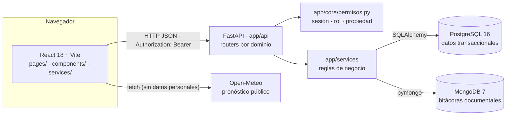
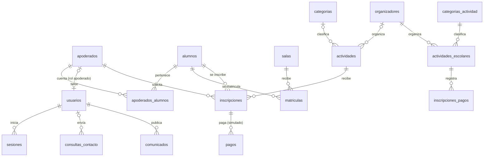

# Arquitectura de datos y catálogo REST · Pequeños Reyes (Hito 3)

**Incidencias:**
- SCRUM-117: diagrama ER y restricciones.
- SCRUM-118: colecciones MongoDB, arquitectura y catálogo REST.
- SCRUM-116 / TEC-22: índices, privacidad y consultas de auditoría.

**Fuente:** generado el 09-11-2026 a partir del código real:
- migraciones `sql/migraciones/V001`–`V007`;
- índices leídos con `mongosh` en el stack de Docker;
- catálogo REST obtenido de `/openapi.json` de la API en ejecución.

Todos los datos de ejemplo son ficticios.

## 1. Arquitectura de componentes



| Componente | Qué guarda o hace |
|---|---|
| **PostgreSQL** (fuente de verdad) | Usuarios, sesiones, alumnos, matrículas, eventos, inscripciones, pagos simulados, comunicados, pre-matrículas y consultas |
| **MongoDB** | Registros de solo agregar: auditoría y bitácora de comunicados |
| **Docker Compose** | Levanta los 4 servicios, con puertos publicados solo en `127.0.0.1` |

## 2. Diagrama ER (PostgreSQL) — SCRUM-117



**Claves por tabla:**

| Tabla | PK | FK | Únicos |
|---|---|---|---|
| `usuarios` | `id` | `apoderado_id` → apoderados | `email`, `apoderado_id` |
| `sesiones` | `id` | `usuario_id` → usuarios (CASCADE) | `token_hash` |
| `apoderados` | `id` | — | `email`, `rut_hash` |
| `alumnos` | `id` | — | `codigo` |
| `apoderados_alumnos` | (`apoderado_id`, `alumno_id`) | ambas (CASCADE) | — |
| `salas` | `id` | — | `nombre` |
| `matriculas` | `id` | `alumno_id`, `sala_id` (RESTRICT) | (`alumno_id`, `anio_escolar`) |
| `actividades` (eventos HU-19) | `id` | `categoria_id`, `organizador_id` | `codigo` |
| `inscripciones` | `id` | `actividad_id`, `alumno_id`, `apoderado_id` | (`actividad_id`, `alumno_id`) |
| `pagos` | `id` | `inscripcion_id` | `referencia`; un pago `aprobado` por inscripción (índice parcial) |
| `comunicados` | `id` | `autor_usuario_id` | — |
| `solicitudes_prematricula` | `id` | — | `codigo`; una en curso por (`rut`, `nombre_parvulo`, `nivel`) |
| `consultas_contacto` | `id` | `usuario_id` (SET NULL) | `codigo` |
| `categorias`, `categorias_actividad`, `organizadores` | `id` | — | `nombre` / `email` |
| `actividades_escolares` (HU-18) | `id` | `categoria_id`, `organizador_id` | — |
| `inscripciones_pagos` (HU-20) | `id` | `actividad_id` | `codigo_comprobante` |
| `institucion` | `id` (fila única) | — | — |

### Restricciones de integridad principales

| Tabla | Restricción | Regla de negocio que protege |
|---|---|---|
| `usuarios` | `ck_usuarios_rol`, `ck_usuarios_apoderado_segun_rol`, `ck_usuarios_email_minusculas` | Rol válido; solo una cuenta de apoderado se liga a un apoderado |
| `sesiones` | `ck_sesiones_expiracion` | La sesión vence después de crearse |
| `matriculas` | `ck_matricula_estado`, `ck_matricula_anio` | Estados y años válidos |
| `actividades` | `ck_actividades_cupo_positivo`, `ck_actividades_costo_no_negativo` | Cupos y costos válidos. El sobrecupo se evita además con `SELECT … FOR UPDATE` (HU-19) |
| `inscripciones` | `ck_inscripcion_estado` | Solo `inscrita` o `cancelada` |
| `pagos` | `ck_pagos_metodo_simulado`, `ck_pagos_referencia_simulada`, `ck_pagos_moneda` | Solo pagos ficticios en CLP |
| `comunicados` | `ck_comunicados_nivel`, `ck_comunicados_vigencia` | Vigencia coherente con la publicación |
| `solicitudes_prematricula` | `ck_prematricula_estado`, `ck_prematricula_nivel` | Estados y niveles del jardín |
| `consultas_contacto` | `ck_contacto_estado`, `ck_contacto_mensaje`, `ck_contacto_correo_minusculas` | Estados nuevo / en_gestion / cerrado |
| `actividades_escolares` | `ck_actividad_cupos_rango`, `ck_actividad_estado` | Cupos ocupados dentro de la capacidad |

**Evidencia de que las restricciones funcionan sobre PostgreSQL real:**
- `docs/evidencia/TEC-16`
- `docs/sprint3/daniel/remediacion/ACTA_REMEDIACION_POSTAUDITORIA_S3_DANIEL.md` §3 (V006/V007)

## 3. Colecciones MongoDB — SCRUM-118 y SCRUM-116

| Colección | Uso | Escrita por | Consultada por |
|---|---|---|---|
| `auditoria_eventos` | Bitácora de accesos, inscripciones y cambios de estado | `app/services/auditoria.py::registrar` (después del commit SQL) | `GET /auditoria/eventos` (dirección) y `GET /panel/participacion/historial` (personal) |
| `bitacora_comunicados` | Historial de crear, editar y eliminar comunicados | `app/services/comunicados.py` | `GET /comunicados/{id}/bitacora` |

**Por qué documental y no SQL (TEC-22 CA4):**
- Son eventos de solo agregar, con campos que varían por tipo y sin relaciones que mantener.
- No replican entidades: la inscripción, la consulta o el usuario siguen en PostgreSQL. Mongo guarda
  solo *quién hizo qué y cuándo* (ids y estados).
- El volumen crece sin afectar las tablas transaccionales.

### Esquema documental de `auditoria_eventos` (TEC-22 CA1)

Documento real del stack de prueba:

```json
{ "tipo": "inscripcion_creada", "resultado": "exito", "actor_id": null, "rol": null,
  "recurso": {"tipo": "actividad", "id": 26},
  "datos": {"apoderado_id": 1, "alumno_id": 3, "cupos_disponibles": 2},
  "fecha": "2026-11-09T18:47:00.973Z" }
```

- **Tipos:** `acceso_login`, `acceso_logout`, `acceso_denegado`, `inscripcion_creada`,
  `inscripcion_cancelada`, `contacto_creado`, `contacto_estado_cambiado`.
- **Resultados:** `exito`, `fallido`, `denegado`.
- **Minimización:** `datos` solo admite la lista blanca `CLAVES_DATOS`; cualquier otra clave se
  descarta. Nunca se guarda correo, RUT, teléfono, contraseña, token ni nombre de niños (probado en
  `tests_s3_daniel.py`).

### Índices verificados con `mongosh` en el stack (TEC-22 CA2)

| Colección | Índice | Clave | Consulta que atiende |
|---|---|---|---|
| `auditoria_eventos` | `ttl_fecha` | `{fecha: -1}`, **TTL 31.536.000 s (365 días)** | Retención automática y orden por fecha |
| `auditoria_eventos` | `tipo_fecha` | `{tipo: 1, fecha: -1}` | Filtro por tipo, más reciente primero |
| `auditoria_eventos` | `recurso_fecha` | `{recurso.tipo: 1, recurso.id: 1, fecha: -1}` | Historial de un evento (panel HU-24) |
| `auditoria_eventos` | `actor_fecha` | `{actor_id: 1, fecha: -1}` | Actividad de una cuenta |
| `bitacora_comunicados` | `comunicado_id_1_fecha_1` | `{comunicado_id: 1, fecha: 1}` | Historial de un comunicado |
| `bitacora_comunicados` | `usuario_id_1_fecha_-1` | `{usuario_id: 1, fecha: -1}` | Cambios hechos por una cuenta |

### Consulta, errores y retención (TEC-22 CA3 y CA4)

- **Consulta:** `GET /auditoria/eventos?tipo=&actor_id=&recurso_tipo=&recurso_id=&resultado=&desde=&hasta=&pagina=&tamano=`.
  - Ordena por fecha descendente; `tamano` va de 1 a 100.
  - Responde 400 con fechas invertidas, 401 sin sesión, 403 si la cuenta no es de dirección y 503
    si MongoDB no está disponible.
- **Fallos al escribir:** si MongoDB cae, la operación SQL se guarda igual y el evento se pierde
  (queda un aviso en el log). No hay transacción distribuida.
- **Retención:** 365 días mediante índice TTL (`AUDITORIA_RETENCION_DIAS`).
- **Persistencia tras reinicio:** comprobada con `down` sin `-v` y luego `up`. Ver
  `docs/sprint3/cierre_seguridad/evidencias/C-02` (`S3-P2`).

## 4. Catálogo REST (generado desde `/openapi.json`) — SCRUM-118

Prefijo `/api/v1`. La columna «Códigos» lista las respuestas declaradas en OpenAPI. Los 401/403
aplican según la política de autorización de la sección 5. `GET /health` (fuera del prefijo) lo usa
el healthcheck de Docker.

| Método | Ruta | Resumen | Cuerpo (DTO) | Respuesta (DTO) | Códigos |
|---|---|---|---|---|---|
| GET | `/actividades` | Listar Actividades | — | lista de ActividadEscolarOut | 200, 400, 401, 403, 404, 409, 503 |
| POST | `/actividades` | Crear Actividad | ActividadEscolarIn | ActividadEscolarOut | 201, 400, 401, 403, 404, 409, 503 |
| PATCH | `/actividades/{actividad_id}` | Actualizar Actividad | ActividadEscolarUpdate | ActividadEscolarOut | 200, 400, 401, 403, 404, 409, 503 |
| POST | `/actividades/{actividad_id}/cancelar` | Cancelar Actividad | — | ActividadEscolarOut | 200, 400, 401, 403, 404, 409, 503 |
| POST | `/actividades/{actividad_id}/publicar` | Publicar Actividad | — | ActividadEscolarOut | 200, 400, 401, 403, 404, 409, 503 |
| GET | `/alumnos` | Listar Alumnos | — | lista de AlumnoOut | 200, 400, 401, 403, 404, 409, 503 |
| GET | `/apoderados/{apoderado_id}/comunicados` | Comunicados vigentes de un apoderado (General + niveles de sus hijos) | — | ComunicadosPertinentesOut | 200, 400, 401, 403, 404, 409, 503 |
| GET | `/apoderados/{apoderado_id}/inscripciones` | Inscripciones de los hijos de un apoderado (el propio apoderado o el personal) | — | lista de InscripcionApoderadoOut | 200, 400, 401, 403, 404, 409, 503 |
| GET | `/auditoria/eventos` | Bitácora filtrada y paginada (solo dirección) | — | PaginaAuditoriaOut | 200, 400, 401, 403, 404, 409, 503 |
| POST | `/auth/login` | Iniciar sesión (email + contraseña) | LoginIn | LoginOut | 200, 400, 401, 403, 404, 409, 503 |
| POST | `/auth/logout` | Cerrar sesión (revoca el token en el servidor) | — | — | 204, 400, 401, 403, 404, 409, 503 |
| GET | `/auth/yo` | Perfil de la sesión actual | — | PerfilOut | 200, 400, 401, 403, 404, 409, 503 |
| GET | `/categorias` | Listar categorías de actividades | — | lista de CategoriaOut | 200, 400, 401, 403, 404, 409, 503 |
| POST | `/categorias` | Crear una categoría | CategoriaIn | CategoriaOut | 201, 400, 401, 403, 404, 409, 503 |
| GET | `/categorias-actividad` | Listar Categorias | — | lista de CategoriaActividadOut | 200, 400, 401, 403, 404, 409, 503 |
| POST | `/categorias-actividad` | Crear Categoria | CategoriaActividadIn | CategoriaActividadOut | 201, 400, 401, 403, 404, 409, 503 |
| PATCH | `/categorias-actividad/{categoria_id}` | Actualizar Categoria | CategoriaActividadUpdate | CategoriaActividadOut | 200, 400, 401, 403, 404, 409, 503 |
| GET | `/comunicados` | Listar y filtrar comunicados vigentes | — | lista de ComunicadoOut | 200, 400, 401, 403, 404, 409, 503 |
| POST | `/comunicados` | Publicar (dirección o personal) | ComunicadoIn | ComunicadoOut | 201, 400, 401, 403, 404, 409, 503 |
| GET | `/comunicados/{comunicado_id}` | Ver un comunicado | — | ComunicadoOut | 200, 400, 401, 403, 404, 409, 503 |
| PATCH | `/comunicados/{comunicado_id}` | Modificar (dirección o su autor) | ComunicadoUpdate | ComunicadoOut | 200, 400, 401, 403, 404, 409, 503 |
| DELETE | `/comunicados/{comunicado_id}` | Eliminar (dirección o su autor) | — | — | 204, 400, 401, 403, 404, 409, 503 |
| GET | `/comunicados/{comunicado_id}/bitacora` | Historial de cambios del comunicado (MongoDB) | — | lista de EntradaBitacoraOut | 200, 400, 401, 403, 404, 409, 503 |
| POST | `/contacto` | Enviar una consulta a dirección | ConsultaIn | ConsultaCreadaOut | 201, 400, 401, 403, 404, 409, 503 |
| GET | `/contacto` | Listar consultas (solo dirección) | — | lista de ConsultaOut | 200, 400, 401, 403, 404, 409, 503 |
| GET | `/contacto/mias` | Mis consultas (sesión iniciada) | — | lista de SeguimientoContactoOut | 200, 400, 401, 403, 404, 409, 503 |
| POST | `/contacto/seguimiento` | Estado de una consulta con código + correo | SeguimientoContactoIn | SeguimientoContactoOut | 200, 400, 401, 403, 404, 409, 503 |
| PATCH | `/contacto/{consulta_id}/estado` | Cambiar el estado de atención (solo dirección) | CambioEstadoContactoIn | ConsultaOut | 200, 400, 401, 403, 404, 409, 503 |
| GET | `/documentos` | Listar Documentos | — | lista de DocumentoOut | 200, 400, 401, 403, 404, 409, 503 |
| POST | `/documentos` | Crear Documento | DocumentoIn | DocumentoOut | 201, 400, 401, 403, 404, 409, 503 |
| PATCH | `/documentos/{documento_id}` | Actualizar Documento | DocumentoUpdate | DocumentoOut | 200, 400, 401, 403, 404, 409, 503 |
| GET | `/eventos` | Listar eventos con sus cupos (público) | — | lista de ActividadOut | 200, 400, 401, 403, 404, 409, 503 |
| POST | `/eventos` | Crear un evento (personal) | ActividadIn | ActividadOut | 201, 400, 401, 403, 404, 409, 503 |
| GET | `/eventos/{actividad_id}` | Ver un evento (público) | — | ActividadOut | 200, 400, 401, 403, 404, 409, 503 |
| PATCH | `/eventos/{actividad_id}` | Modificar un evento (personal) | ActividadUpdate | ActividadOut | 200, 400, 401, 403, 404, 409, 503 |
| DELETE | `/eventos/{actividad_id}` | Eliminar un evento sin inscripciones (personal) | — | — | 204, 400, 401, 403, 404, 409, 503 |
| GET | `/eventos/{actividad_id}/asistentes` | Asistentes y su estado (personal) | — | AsistentesOut | 200, 400, 401, 403, 404, 409, 503 |
| POST | `/eventos/{actividad_id}/inscripciones` | Inscribir a un hijo (apoderado de la sesión) o en su nombre (personal) | InscripcionIn | InscripcionOut | 201, 400, 401, 403, 404, 409, 503 |
| POST | `/inscripciones/{inscripcion_id}/cancelar` | Cancelar una inscripción | CancelacionIn | InscripcionOut | 200, 400, 401, 403, 404, 409, 503 |
| POST | `/inscripciones/{inscripcion_id}/pagos` | Pago SIMULADO | PagoIn | PagoOut | 201, 400, 401, 403, 404, 409, 503 |
| GET | `/inscripciones/{inscripcion_id}/pagos` | Pagos de una inscripción | — | lista de PagoOut | 200, 400, 401, 403, 404, 409, 503 |
| GET | `/institucion` | Datos institucionales del jardín | — | InstitucionOut | 200, 400, 401, 403, 404, 409, 503 |
| GET | `/matriculas` | Listar Matriculas | — | lista de MatriculaOut | 200, 400, 401, 403, 404, 409, 503 |
| POST | `/matriculas` | Crear Matricula | MatriculaIn | MatriculaOut | 201, 400, 401, 403, 404, 409, 503 |
| GET | `/organizadores` | Listar Organizadores | — | lista de OrganizadorOut | 200, 400, 401, 403, 404, 409, 503 |
| POST | `/organizadores` | Crear Organizador | OrganizadorIn | OrganizadorOut | 201, 400, 401, 403, 404, 409, 503 |
| PATCH | `/organizadores/{organizador_id}` | Actualizar Organizador | OrganizadorUpdate | OrganizadorOut | 200, 400, 401, 403, 404, 409, 503 |
| GET | `/pagos` | Listar Pagos | — | lista de PagoInscripcionOut | 200, 400, 401, 403, 404, 409, 503 |
| POST | `/pagos` | Registrar Pago | PagoInscripcionIn | PagoInscripcionOut | 201, 400, 401, 403, 404, 409, 503 |
| GET | `/pagos/comprobante/{codigo}` | Consultar Comprobante | — | PagoInscripcionOut | 200, 400, 401, 403, 404, 409, 503 |
| PATCH | `/pagos/{pago_id}/estado` | Actualizar Estado Pago | PagoEstadoUpdate | PagoInscripcionOut | 200, 400, 401, 403, 404, 409, 503 |
| GET | `/panel/participacion` | Indicadores de inscritos y ocupación (SQL) | — | PanelOut | 200, 400, 401, 403, 404, 409, 503 |
| GET | `/panel/participacion/historial` | Historial de inscripciones (MongoDB) | — | PaginaAuditoriaOut | 200, 400, 401, 403, 404, 409, 503 |
| GET | `/portal/alumnos` | Hijos del apoderado (relación SQL) | — | lista de AlumnoPortalOut | 200, 400, 401, 403, 404, 409, 503 |
| GET | `/portal/alumnos/{alumno_id}` | Ficha de un hijo (403 si no es suyo) | — | FichaAlumnoOut | 200, 400, 401, 403, 404, 409, 503 |
| POST | `/prematriculas` | Enviar una pre-matrícula (familia) | SolicitudIn | SolicitudCreadaOut | 201, 400, 401, 403, 404, 409, 503 |
| GET | `/prematriculas` | Listar solicitudes (dirección) | — | lista de SolicitudOut | 200, 400, 401, 403, 404, 409, 503 |
| POST | `/prematriculas/seguimiento` | Consultar el estado con código + correo (familia) | SeguimientoIn | SeguimientoOut | 200, 400, 401, 403, 404, 409, 503 |
| PATCH | `/prematriculas/{solicitud_id}/estado` | Cambiar el estado (dirección) | CambioEstadoIn | SolicitudOut | 200, 400, 401, 403, 404, 409, 503 |
| GET | `/salas` | Listar Salas | — | lista de SalaOut | 200, 400, 401, 403, 404, 409, 503 |
| GET | `/salas/cupos` | Cupos por sala (matriculados calculados en SQL) | — | lista de CupoSalaOut | 200, 400, 401, 403, 404, 409, 503 |
| GET | `/sesion/cuentas-demo` | Cuentas ficticias para probar la demo | — | — | 200, 400, 401, 403, 404, 409, 503 |
| GET | `/sesion/yo` | Perfil de la cuenta enviada en X-Usuario-Id | — | — | 200, 400, 401, 403, 404, 409, 503 |
| GET | `/health` | Health | — | — | 200 |

## 5. Política de autorización (tras el cierre de H-01/H-02/H-03)

| Grupo | Regla |
|---|---|
| Lectura pública | Catálogo de eventos y actividades publicadas, salas y cupos, categorías, organizadores, documentos vigentes, comunicados vigentes, institución |
| Familias (apoderado con sesión) | Su portal, sus hijos, inscribir/cancelar/pagar **solo a sus hijos** (el apoderado sale del token), sus consultas y sus comunicados pertinentes |
| Personal (`organizador`, `administrador`) | Gestión de eventos y actividades escolares, asistentes, listado de alumnos, panel de participación |
| Dirección (`administrador`) | Organizadores y categorías, documentos, pagos, matrículas, pre-matrículas, consultas de contacto, bitácora de auditoría |
| Identidad | Token Bearer (login real). `X-Usuario-Id` solo existe con `PERMITIR_IDENTIDAD_DEMO=true` en development o test. `X-Rol` nunca otorga permisos |

**Pruebas de aceptación:**
- `scripts/prueba_cierre_h02.py`: 29 casos de rol y propiedad.
- `scripts/sonda_rutas_abiertas_s3.py`: 0/12 rutas abiertas.
