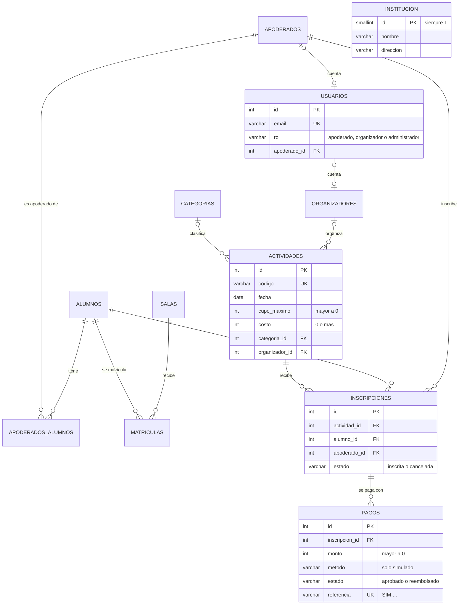

# Modelo PostgreSQL y migraciones reproducibles (TEC-16)

> **ID estable:** PR-S3/TEC-16 · Referencias previas: SCRUM-62, 63 · Dependencia: SCRUM-93
> **Responsable propuesto:** Mirko Massa · **Revisor cruzado:** Daniel Cortez
> **Estado:** implementado y pendiente de revisión. No marcar como finalizado sin la revisión de Daniel y la evidencia del equipo (ver «Qué falta»).

**En pocas palabras:**
- La base de datos PostgreSQL del jardín ahora se arma con **migraciones**: archivos numerados que crean las tablas siempre en el mismo orden y de la misma forma, partiendo de una base vacía. Cualquier integrante obtiene exactamente la misma base con un solo comando.
- Se agregaron las tablas de **usuarios, organizadores, categorías, pagos ficticios y datos del jardín**.
- La API tiene ahora un **CRUD** para administrarlas.

---

## ¿Qué cambió?

### Antes

El esquema se creaba de **dos maneras** que podían no coincidir:
1. `sql/001_schema.sql`, que Docker solo ejecutaba la **primera vez** que se creaba el volumen.
2. `Base.metadata.create_all()`, que la API ejecutaba al arrancar y que crea tablas desde los modelos de Python.

Si alguien cambiaba un modelo, su base quedaba distinta a la de los demás, y no había registro de qué cambios tenía aplicada cada base.

### Ahora

```
backend/sql/
├── migrar.sh                    ← el ejecutor de migraciones
├── initdb/00_migrar.sh          ← lo llama Docker solo, con una base nueva
├── migraciones/                 ← SOLO el esquema (tablas, restricciones, índices)
│   ├── V001__esquema_base.sql             (el 001_schema.sql original, sin cambios)
│   ├── V002__inscripciones.sql            (HU-19)
│   └── V003__usuarios_eventos_pagos_institucion.sql   (TEC-16)
└── seed/
    └── S001__datos_demo.sql     ← SOLO datos de demostración, todos ficticios
```

- **Las migraciones son la única fuente del esquema.** Se quitó `create_all()` de la API.
- **El ejecutor lleva un registro** en la tabla `schema_migraciones`: qué versión se aplicó, cuándo y con qué suma SHA-256. Solo aplica las que faltan.
- **Cada migración se aplica en una transacción:** si falla a la mitad, se deshace completa y no queda nada a medias.
- **Si alguien edita una migración que ya se aplicó, el ejecutor se detiene con error.** Los cambios de esquema siempre se hacen con una migración **nueva** (`V004`, `V005`…).
- **Funciona igual en Windows y Linux:** la suma ignora los saltos de línea CRLF, y `.gitattributes` obliga a que los `.sh` se guarden con saltos LF.

---

## El modelo



| Tabla | Para qué | Migración |
|---|---|---|
| `apoderados`, `alumnos`, `apoderados_alumnos` | Familias y la relación apoderado–alumno | V001 (ya existía) |
| `salas`, `matriculas` | Salas y matrículas | V001 (ya existía) |
| `actividades` | Los **eventos** del jardín: salidas, talleres… Se les agregó categoría, organizador y costo | V002 + V003 |
| `inscripciones` | Inscripción de un alumno a una actividad (HU-19) | V002 |
| `usuarios` | Cuentas para el futuro inicio de sesión, con rol `apoderado`, `organizador` o `administrador` | **V003** |
| `organizadores` | Personal del jardín que organiza actividades | **V003** |
| `categorias` | Tipo de actividad: Taller, Salida pedagógica… | **V003** |
| `pagos` | Pagos **ficticios** de inscripciones a actividades con costo | **V003** |
| `institucion` | Datos del jardín: nombre, dirección, teléfono, horario | **V003** |
| `schema_migraciones` | Registro de qué migraciones se aplicaron | La crea `migrar.sh` |

> **«Eventos» = actividades.** El ticket habla de «eventos». En Pequeños Reyes, eso corresponde a las **actividades** de HU-19. Se ampliaron esas mismas tablas en vez de crear una tabla `eventos` paralela, que duplicaría las inscripciones.

### Reglas que la propia base de datos garantiza (CA2)

Aunque la API tuviera un error, PostgreSQL rechaza por sí solo estos casos. **Los 17 se probaron** (ver «Evidencia»):

| Regla | Restricción |
|---|---|
| Un alumno, una inscripción por actividad | `UNIQUE (actividad_id, alumno_id)` |
| Como máximo **un pago aprobado** por inscripción (puede haber varios reembolsados) | Índice único parcial `uq_pagos_aprobado_por_inscripcion` |
| Los pagos **solo pueden ser simulados**: método `simulado` y referencia `SIM-…` | `ck_pagos_metodo_simulado`, `ck_pagos_referencia_simulada` |
| Montos, cupos y costos válidos | `monto > 0`, `cupo_maximo > 0`, `costo >= 0` |
| Estados válidos | `inscrita`/`cancelada`; `aprobado`/`reembolsado` |
| Correos únicos y en minúsculas | `UNIQUE` + `CHECK (email = lower(email))` |
| Un usuario con rol apoderado debe estar ligado a un apoderado, y ningún otro rol puede estarlo | `ck_usuarios_apoderado_segun_rol` |
| Una sola fila de datos institucionales | `CHECK (id = 1)` |
| No se pueden borrar datos que otros usan: una categoría con actividades, una inscripción con pagos, un alumno con inscripciones | Claves foráneas `ON DELETE RESTRICT` |
| Si se borra la cuenta de usuario de un organizador, el organizador se mantiene sin cuenta | `ON DELETE SET NULL` |

### Privacidad: solo datos ficticios (CA3 y CA5)

- La semilla `S001__datos_demo.sql` **solo contiene datos inventados**: correos `@ejemplo.cl`, alumnos `DEMO-A01`…`A06` llamados «Alumno Demo», y la dirección «Calle Ficticia 123».
- **No se guardan fechas de nacimiento** de los alumnos demo.
- **Pagos:** la tabla **no tiene columnas** para tarjetas ni cuentas bancarias, y la base rechaza cualquier método que no sea `simulado`.
- **Contraseñas:** los usuarios demo tienen `password_hash = 'demo-sin-contrasena'`, que no es un hash real, así que **no permiten iniciar sesión**. Cuando exista autenticación, la aplicación generará hashes reales.
- **Prueba automática:** la prueba de la API revisa que ningún apoderado, usuario, organizador ni alumno esté fuera de `@ejemplo.cl` o `DEMO-*`.

---

## CRUD en la API (CA4)

Todas las rutas están en Swagger (`http://localhost:8000/docs`).

| Recurso | Endpoints nuevos | Reglas |
|---|---|---|
| **Datos del jardín** | `GET /api/v1/institucion` | — |
| **Categorías** | `GET`, `POST /api/v1/categorias` | Nombre repetido → 409 |
| **Organizadores** | `GET`, `POST /api/v1/organizadores` | Correo repetido → 409; correo inválido → 400 |
| **Actividades** | `POST /api/v1/actividades`, `PATCH` y `DELETE /api/v1/actividades/{id}` | Ver abajo |
| **Pagos simulados** | `POST`, `GET /api/v1/inscripciones/{id}/pagos` | Ver abajo |

**Actividades:**
- **Crear:** el código es único y va en MAYÚSCULAS. La categoría y el organizador deben existir (si no, 404). Cupo entre 1 y 500, costo de 0 o más.
- **Modificar (`PATCH`):** se cambia solo lo que se envía. **No se puede bajar el cupo por debajo de los inscritos** (409). La actividad se bloquea con `FOR UPDATE`, para no cruzarse con una inscripción simultánea.
- **Eliminar:** solo si **no tiene inscripciones**; si tiene, responde 409, para conservar el historial. Una actividad que no debe recibir más inscripciones se **cierra** con `inscripciones_abiertas = false`.

**Pagos simulados:**
- Solo el apoderado del alumno puede pagar (si no, 403), y solo inscripciones vigentes de actividades con costo.
- No se puede pagar dos veces la misma inscripción (409). La inscripción se bloquea mientras se paga, así dos pagos simultáneos no pasan los dos.
- El monto es siempre el costo de la actividad y la referencia se genera sola (`SIM-XXXXXXXXXXXX`).

**Transacción:** al **cancelar** una inscripción pagada (HU-19), la cancelación y el **reembolso** del pago se guardan **en la misma transacción**: o se guardan los dos o ninguno.

---

## Cómo usarlo

Todos los comandos se ejecutan desde `HITO-3/backend`.

### Si ya tenías el proyecto levantado (volumen existente)

```bash
docker compose up -d --build
docker compose exec postgres sh /sql/migrar.sh
```

El ejecutor detecta las tablas que ya existían, porque las migraciones usan `IF NOT EXISTS`, **no borra ningún dato** y aplica solo lo nuevo. Esto se probó sobre una base creada con el `001_schema.sql` y el `002_inscripciones.sql` antiguos, con una inscripción dentro: la inscripción se conservó.

La salida se ve así:

```
== Migraciones de PostgreSQL (/sql/migraciones) ==
  + V001__esquema_base aplicada
  + V002__inscripciones aplicada
  + V003__usuarios_eventos_pagos_institucion aplicada
Migraciones nuevas aplicadas: 3
== Datos de demostración (/sql/seed) ==
  + S001__datos_demo.sql cargado
Listo.
```

Si lo vuelves a ejecutar, muestra `= ... (ya aplicada)` y `Migraciones nuevas aplicadas: 0`.

### Partir desde una base vacía (CA1)

> ⚠️ `docker compose down -v` **borra todos los datos** de PostgreSQL y MongoDB de tu computador. Hazlo solo si no te importa perderlos.

```bash
docker compose down -v
docker compose up -d --build
docker compose logs postgres | grep -E "aplicada|cargado|Listo"
```

Con el volumen vacío, PostgreSQL ejecuta las migraciones y la semilla **solo**, la primera vez que arranca.

Si no quieres borrar tus datos, el script de evidencia de abajo prueba lo mismo en **bases temporales** que crea y borra por su cuenta.

### Agregar un cambio de esquema en el futuro

1. Crea `sql/migraciones/V004__descripcion_corta.sql` con el cambio, por ejemplo `ALTER TABLE ...`.
2. Actualiza el modelo en `app/db/models.py` para que coincida.
3. Ejecuta `docker compose exec postgres sh /sql/migrar.sh`.
4. **Nunca edites `V001` a `V003`**: el ejecutor lo detectaría y se detendría.

---

## Cómo probar

### 1. Pruebas de la base de datos (sin tocar tus datos)

```bash
bash docs/evidencia/TEC-16/pruebas-postgresql.sh
```

Crea bases temporales `tec16_*` dentro de tu PostgreSQL de Docker y las borra al terminar. Comprueba:
- Que las migraciones funcionan desde una base vacía y que se pueden repetir.
- Las 17 restricciones.
- Que una migración que falla no deja nada a medias.
- Que la semilla es solo ficticia.

### 2. Prueba de la API, con reinicio en medio (CA4)

```bash
docker compose exec api python -m scripts.prueba_tec16 crear
docker compose restart
docker compose exec api python -m scripts.prueba_tec16 verificar
```

- **`crear`** (30 casos): migraciones registradas, datos del jardín, CRUD completo de categorías, organizadores y actividades, inscripción, pago simulado, cancelación con reembolso en la misma transacción, 17 casos de error (400, 403, 404 y 409) y la revisión de datos ficticios. Deja una actividad de control.
- **`verificar`** (4 casos): después del reinicio, comprueba que la actividad, sus cambios, sus inscripciones y sus pagos siguen intactos. Luego borra todo lo de prueba.

Cada fase termina con `Resultado: N/N PASS`. Guarda las salidas como evidencia:

```bash
docker compose exec api python -m scripts.prueba_tec16 crear > docs/evidencia/TEC-16/prueba-api-crear.txt
docker compose restart
docker compose exec api python -m scripts.prueba_tec16 verificar > docs/evidencia/TEC-16/prueba-api-verificar.txt
```

### 3. Indisponibilidad (503)

```bash
docker compose stop postgres
# En Swagger: GET /api/v1/categorias  →  503 "Servicio de datos temporalmente no disponible"
docker compose start postgres
```

---

## Evidencia

Todo lo de base de datos se ejecutó en un **PostgreSQL 16 real**:

| Prueba | Resultado |
|---|---|
| Migraciones desde una base **vacía** | ✅ V001, V002 y V003 aplicadas; semilla cargada |
| Volver a ejecutar el migrador | ✅ 0 migraciones nuevas, sin datos duplicados |
| Migrar una base **existente**, creada con los scripts antiguos y con datos | ✅ Se conservaron los datos |
| Arranque automático de Docker (`initdb/00_migrar.sh`) con el mismo `/sql` y las mismas variables de entorno | ✅ |
| Migración que falla a la mitad | ✅ Se deshizo completa; no quedó ninguna tabla a medias |
| Editar una migración ya aplicada | ✅ El ejecutor se detiene con error |
| La misma migración con saltos de línea de Windows (CRLF) | ✅ Se reconoce como ya aplicada |
| 17 restricciones del modelo | ✅ Todas rechazan el dato inválido |
| Datos idénticos después de **reiniciar PostgreSQL** | ✅ La huella MD5 de pagos, actividades y migraciones es igual antes y después |
| Semilla: datos fuera de `@ejemplo.cl` o `DEMO-*` | ✅ 0 |

Los detalles están en `docs/evidencia/TEC-16/pruebas-postgresql.txt`.

> **Importante:** la **API** (FastAPI) **no se pudo ejecutar** en el entorno donde se programó, porque no se podían instalar sus dependencias. El código Python se revisó con `py_compile` y `pyflakes`. La prueba de la API (`prueba_tec16`) la debe ejecutar el equipo en Docker.

---

## Decisiones tomadas (validar con el equipo y el revisor)

1. **Se quitó `create_all()` de la API** (`app/main.py`). Es un cambio sobre código entregado, pero era necesario: con dos fuentes de esquema, las migraciones no serían reproducibles. Ahora, si alguien levanta la API sin migrar, las consultas a tablas que faltan responden 503 hasta ejecutar `migrar.sh`.
2. **Migraciones con SQL y `sh`, sin Alembic.** Alembic es la herramienta habitual con SQLAlchemy, pero agrega dependencias y una capa más que aprender. Las migraciones en SQL puro se leen directamente, se ejecutan dentro del contenedor de PostgreSQL y se pudieron probar contra PostgreSQL real. Si el equipo prefiere Alembic, se puede migrar a él más adelante tomando estas versiones como base.
3. **Eventos = actividades** (ver «El modelo»).
4. **Datos institucionales ficticios:** el criterio exige una semilla exclusivamente ficticia, así que se usó una dirección y un teléfono inventados. Si se quieren los datos reales del jardín, que no son datos personales, hay que decidirlo con el docente.
5. **Usuarios sin endpoints todavía:** la tabla queda lista para el inicio de sesión, pero crear y autenticar usuarios corresponde a otra historia.
6. **Restricción académica:** si estas funciones equivalen al **caso 3.6** de la pauta (eventos, organizadores, categorías, pagos), hay que **ratificar con el docente** su correspondencia con Pequeños Reyes. No se asume aprobada.

## Qué falta para cerrar la tarea

- [ ] Ejecutar en Docker `bash docs/evidencia/TEC-16/pruebas-postgresql.sh` y las dos fases de `prueba_tec16`, y guardar las salidas en `docs/evidencia/TEC-16/`.
- [ ] Probar el arranque desde una base vacía (`down -v` y `up`) en al menos un computador del equipo.
- [ ] Capturas de Swagger del CRUD y de un error 409.
- [ ] Probar el 503 deteniendo PostgreSQL.
- [ ] Pantallas en React, si el equipo lo incluye en el alcance.
- [ ] PR revisado por Daniel Cortez.

---

<details>
<summary><strong>Detalle técnico: archivos</strong></summary>

| Archivo | Cambio |
|---|---|
| `sql/migrar.sh` | **Nuevo.** Ejecutor de migraciones: registro, transacciones, sumas SHA-256 y semilla. Es `sh` POSIX, compatible con `postgres:16-alpine`. |
| `sql/initdb/00_migrar.sh` | **Nuevo.** Llama a `migrar.sh` en el primer arranque de PostgreSQL. |
| `sql/migraciones/V001__esquema_base.sql` | El `sql/001_schema.sql` original, **sin cambios** (solo un comentario arriba). |
| `sql/migraciones/V002__inscripciones.sql` | El esquema de HU-19 (antes `sql/002_inscripciones.sql`), sin los datos. |
| `sql/migraciones/V003__usuarios_eventos_pagos_institucion.sql` | **Nuevo.** `institucion`, `usuarios`, `organizadores`, `categorias`, `pagos`, y las columnas nuevas e índices de `actividades`. |
| `sql/seed/S001__datos_demo.sql` | Datos demo de HU-19 y TEC-16, todos ficticios e idempotentes. |
| `sql/001_schema.sql`, `sql/002_inscripciones.sql` | **Eliminados:** pasaron a `V001` y `V002` más la semilla. |
| `app/db/models.py` | Modelos `Institucion`, `Usuario`, `Organizador`, `Categoria` y `Pago`; `Actividad` con `categoria_id`, `organizador_id` y `costo`. |
| `app/main.py` | Sin `create_all()` ni `lifespan`; registra el router `catalogo`. |
| `app/schemas/catalogo.py`, `app/services/catalogo.py`, `app/api/catalogo.py` | **Nuevos.** Institución, categorías y organizadores. |
| `app/schemas/inscripciones.py` | `ActividadIn`, `ActividadUpdate`, `PagoIn`, `PagoOut`; `ActividadOut` con los campos nuevos. |
| `app/services/inscripciones.py` | CRUD de actividades, pagos simulados, y reembolso en la misma transacción al cancelar. |
| `app/api/inscripciones.py` | `POST`, `PATCH` y `DELETE /actividades`, y `POST`/`GET` de pagos. |
| `docker-compose.yml` | Monta `./sql` en `/sql` y `00_migrar.sh` en `docker-entrypoint-initdb.d`. |
| `.gitattributes` | **Nuevo.** `*.sh` siempre con saltos LF. |
| `scripts/prueba_tec16.py` | **Nuevo.** Prueba de la API en dos fases (`crear` y `verificar`). |
| `docs/evidencia/TEC-16/` | Script y registro de las pruebas de PostgreSQL. |
| `scripts/prueba_hu19.py`, `docs/HU-19-inscripciones.md` | Actualizados para usar `migrar.sh` en vez de `002_inscripciones.sql`. |

</details>
